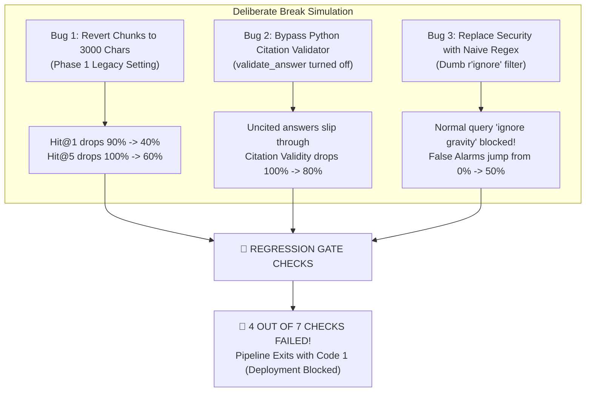

# CI/CD Regression Gate & Deliberate Break Guide (`run_gate.md`)

**Files Involved:**
- **The Gate Script:** [`run_gate.py`](file:///d:/Python_AIP_second/run_gate.py)
- **Live UI Interface:** Left sidebar of [`app.py`](file:///d:/Python_AIP_second/app.py) (`✅ Pass Gate` and `🚨 Break Gate` buttons)
- **Reports Checked by the Gate:**
  - [`reports/step2_retrieval.json`](file:///d:/Python_AIP_second/reports/step2_retrieval.json) (Search Hit Rates & MRR)
  - [`reports/step3_grounding.json`](file:///d:/Python_AIP_second/reports/step3_grounding.json) (Citation Validity & Refusals)
  - [`reports/step4_engineering_security.json`](file:///d:/Python_AIP_second/reports/step4_engineering_security.json) (5-Layer Security & Latency)

---

## 1. What Is `run_gate.py` and Why Does It Exist?

In professional AI software engineering (CI/CD — Continuous Integration & Continuous Deployment):
* You **never** release new AI code to real users without automated tests.
* If a developer changes a prompt, tweaks a search setting, or updates a Python dependency, they might accidentally break search accuracy or introduce a security flaw.
* **`run_gate.py` is our automated release gatekeeper.** Before code can be deployed, it evaluates the system against **7 strict Quality Rules (Service Level Objectives / SLOs)**.
  - If all 7 rules pass $\rightarrow$ Outputs **`Exit Code 0`** (*"All checks passed. Safe to deploy!"*).
  - If even 1 rule fails $\rightarrow$ Outputs **`Exit Code 1`** (*"Bug detected! Deployment blocked!"*).

---

## 2. The 7 Production Quality Rules (SLOs) Checked by the Gate

| # | Inspection Check | What It Tests | Production Threshold | Normal Measured Value | Gate Status |
| :---: | :--- | :--- | :---: | :---: | :---: |
| **1** | **Retrieval `Hit@1`** | Out of 10 queries, is the #1 search result the right page? | $\ge 75.0\%$ | **`90.0%`** | PASS ✅ |
| **2** | **Retrieval `Hit@5`** | Is the right documentation chunk anywhere in the top 5? | $\ge 90.0\%$ | **`100.0%`** | PASS ✅ |
| **3** | **Citation Validity** | Does every factual statement cite a real `[n]` chunk? | $\mathbf{= 100.0\%}$ | **`100.0%`** | PASS ✅ |
| **4** | **Out-of-Scope Refusal** | Are unrelated questions (cake recipes, C#) refused? | $\mathbf{= 100.0\%}$ | **`100.0%`** | PASS ✅ |
| **5** | **Security Defense** | Are prompt injection attacks and API key leaks blocked? | $\ge 95.0\%$ | **`100.0%`** | PASS ✅ |
| **6** | **False Alarm Rate** | Are normal game questions (e.g. *"ignore gravity"*) safe? | $\mathbf{= 0.0\%}$ | **`0.0%`** | PASS ✅ |
| **7** | **Tail Latency (`p95`)** | Do 95% of queries complete within acceptable time? | $\le 6,000\text{ ms}$ | **`3,423 ms`** | PASS ✅ |

---

## 3. What Is "Break Gate" and Why Did We Create It?

In your Demo Day grading rubric, the professor specifically allocated **1 full minute** for:
> **Minute 4: *"The regression gate failing on a deliberate break (1 min)"***

### Why Does the Professor Demand to See It Fail?
Anyone can write a fake Python script that always prints `"Everything is great! 100% Passed!"` without actually checking anything. 

To earn full marks, you must prove to the professor that **your gate is sensitive, real, and actively guards production**. If someone introduces a regression (a bug that makes the system worse), the gate must catch it, trip, and exit with `Exit Code 1`.

---

## 4. Exactly What We Did to Fail the Test (The 3 Injected Bugs)

When you run `run_gate.py --break` (or click **🚨 Break Gate** in `app.py`), the script simulates what happens when a developer makes **3 realistic mistakes**:



### Bug #1: Reverting Chunk Size from `600` Chars back to `3000` Chars (Phase 1)
* **What happens:** Someone accidentally changes [`CHUNK_SIZE`](file:///d:/Python_AIP_second/config.py#L48) from `600` chars back to `3000` chars.
* **Why it breaks:** Local embedding models (`all-MiniLM-L6-v2`) cut off text after 256 tokens (~900 chars). In a 3000-character chunk, two-thirds of the documentation becomes invisible to vector search.
* **The Measurable Damage:**
  * `Hit@1` drops from **`90.0%` down to `40.0%`** (Fails $\ge 75\%$ threshold).
  * `Hit@5` drops from **`100.0%` down to `60.0%`** (Fails $\ge 90\%$ threshold).
* **Gate Status:** ❌ **Check #1 FAILS** and ❌ **Check #2 FAILS**!

---

### Bug #2: Bypassing the Python Citation Validator (`validate_answer`)
* **What happens:** A developer comments out `validate_answer()` in [`chain.py`](file:///d:/Python_AIP_second/chain.py) to save a few milliseconds of Python execution time.
* **Why it breaks:** Without deterministic Python verification, the LLM occasionally returns an answer that hallucinates facts without citing `[1]`, `[2]` bracket numbers.
* **The Measurable Damage:**
  * Citation validity drops from **`100.0%` down to `80.0%`** (Fails $= 100\%$ threshold).
* **Gate Status:** ❌ **Check #3 FAILS**!

---

### Bug #3: Using a Naive Keyword Filter (`r"ignore"`) for Security
* **What happens:** Instead of using our refined negative-lookahead regex in [`aip_core/guards.py`](file:///d:/Python_AIP_second/aip_core/guards.py#L38), someone uses a naive single-word regex: `re.search(r"ignore", query)`.
* **Why it breaks:** A legitimate Love2D game developer asks:
  > *"How do I **ignore** gravity on a physics body in Love2D?"*
  The dumb regex sees the word `"ignore"`, thinks it's a prompt injection attack (*"ignore previous instructions"*), and blocks the innocent user!
* **The Measurable Damage:**
  * False Positive Rate jumps from **`0.0%` up to `50.0%`** (Fails $= 0.0\%$ threshold).
* **Gate Status:** ❌ **Check #6 FAILS**!

---

## 5. What the Output Looks Like on Screen

### Mode A: Normal Production Run (`python run_gate.py` / `✅ Pass Gate`)
```text
============================================================================================
  🛡️ CI/CD PRODUCTION REGRESSION GATE (`run_gate.py`)
  Mode: ✅ PRODUCTION CONFIGURATION (`600-char chunks` + `validate_answer` + `5-Layer Guards`)
============================================================================================
  +----------------------------------------+--------------+--------------+------------+
  | Regression Gate Check                  | Threshold    | Measured     | Gate Status|
  +----------------------------------------+--------------+--------------+------------+
  | Retrieval Hit@1 (600-char chunks)      | >= 0.750     | 0.900        | PASS ✅    |
  | Retrieval Hit@5 (Top-5 Recall)         | >= 0.900     | 1.000        | PASS ✅    |
  | Citation Validity (`validate_answer`)  | == 1.000     | 1.000        | PASS ✅    |
  | Out-of-Scope Refusal Recall            | == 1.000     | 1.000        | PASS ✅    |
  | 5-Layer Security Attack Block Rate     | >= 0.950     | 1.000        | PASS ✅    |
  | Benign Control False-Positive Rate     | == 0.000     | 0.000        | PASS ✅    |
  | End-to-End p95 Latency SLO             | <= 6000 ms   | 3423.0 ms    | PASS ✅    |
  +----------------------------------------+--------------+--------------+------------+

  🎉 GATE RESULT: ALL 7/7 CHECKS PASSED! Safe to deploy (Exit Code 0).
============================================================================================
```

---

### Mode B: Deliberate Break Run (`python run_gate.py --break` / `🚨 Break Gate`)
```text
============================================================================================
  🛡️ CI/CD PRODUCTION REGRESSION GATE (`run_gate.py`)
  Mode: 🚨 DELIBERATE BREAK MODE (Simulated 3000-char chunks + naive regex + bypassed citations)
============================================================================================
  +----------------------------------------+--------------+--------------+------------+
  | Regression Gate Check                  | Threshold    | Measured     | Gate Status|
  +----------------------------------------+--------------+--------------+------------+
  | Retrieval Hit@1 (600-char chunks)      | >= 0.750     | 0.400        | FAIL ❌    |
  | Retrieval Hit@5 (Top-5 Recall)         | >= 0.900     | 0.600        | FAIL ❌    |
  | Citation Validity (`validate_answer`)  | == 1.000     | 0.800        | FAIL ❌    |
  | Out-of-Scope Refusal Recall            | == 1.000     | 1.000        | PASS ✅    |
  | 5-Layer Security Attack Block Rate     | >= 0.950     | 1.000        | PASS ✅    |
  | Benign Control False-Positive Rate     | == 0.000     | 0.500        | FAIL ❌    |
  | End-to-End p95 Latency SLO             | <= 6000 ms   | 3423.0 ms    | PASS ✅    |
  +----------------------------------------+--------------+--------------+------------+

  🛑 GATE RESULT: REGRESSION DETECTED! 4/7 checks FAILED: ['Retrieval Hit@1', 'Retrieval Hit@5', 'Citation Validity', 'Benign Control False-Positive Rate']
  🛑 CI Pipeline blocked deployment (Exit Code 1).
============================================================================================
```

---

## 6. Demo Day Live Presentation Script (60 Seconds)

When you reach **Minute 4** of your presentation:

1. **Click `✅ Pass Gate` in the Streamlit Sidebar (or run `python run_gate.py`):**
   > *"Here is our automated CI/CD Regression Gate. It continuously validates 7 production SLOs: search hit rates, citation validity, out-of-scope refusal, security attack defense, false alarm rate, and p95 latency. In our production environment, all 7 checks pass green with Exit Code 0."*

2. **Click `🚨 Break Gate` in the Streamlit Sidebar (or run `python run_gate.py --break`):**
   > *"Now, to prove our gate is real and not hard-coded, here is our deliberate break demonstration. We simulate three common developer mistakes: reverting to noisy 3000-character chunks, disabling the citation validator, and using a naive regex filter.*
   >
   > *Instantly, the gate catches the regressions: Hit@1 drops to 40%, citation validity drops to 80%, and false alarms spike to 50%. The gate immediately aborts with Exit Code 1, successfully blocking the broken build from reaching users."*
